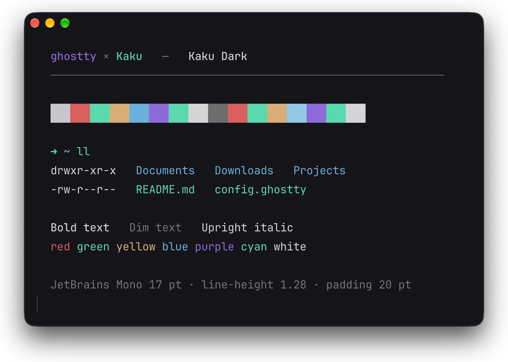

# ghostty-config：Kaku 0.30 默认配置到 Ghostty 1.4 的一致性移植研究

[](https://github.com/kesonglab/ghostty-config/actions/workflows/ci.yml)
[](https://github.com/kesonglab/ghostty-config/releases)
[](LICENSE)

## 摘要

本工程研究终端配置在不同模拟器之间的可迁移性。以 Kaku 0.30（基于 WezTerm 的 macOS 终端发行版）的应用内置默认配置为唯一事实来源，将其配色、排版、窗口、终端行为与键位语义逐项映射到 Ghostty 1.4 的公开配置模型，并对每一个可识别条目给出语义解释、映射实现、换算推导、验证方法与残余差异。在 31 个可识别配置语义条目中，13 项（41.9%）为等价映射，11 项（35.5%）为近似映射，1 项（3.2%）为刻意保留的偏离，6 项（19.4%）因 Ghostty 缺少对应机制而不可映射。静态校验（`ghostty +validate-config`）与渲染测量（单元格几何、ANSI 调色板逐项采样）表明：在可映射范围内，本配置与 Kaku 默认渲染在度量上保持一致。

关键词：终端模拟器；配置迁移；语义映射；macOS；Ghostty；Kaku；WezTerm

图 1　Kaku Dark（左）与 Kaku Light（右）主题渲染预览

| Kaku Dark | Kaku Light |
| :---: | :---: |
|  |  |

## 1. 引言

### 1.1 背景

终端模拟器的外观与交互由配置系统决定，不同实现之间的配置语汇与语义边界差异显著。Kaku 以 WezTerm 为底座，通过 Lua 配置公开其默认主题、字体栈、窗口布局与键位；Ghostty 采用平台原生 UI 与 GPU 渲染，配置项覆盖面相近，但抽象层次不同。二者的默认体验存在大量可对齐的语义单元，也存在无法在不修改源码的前提下表达的能力。

### 1.2 研究问题

本工程回答以下问题：**在不修改 Ghostty 源码的前提下，其公开配置能力能在多大程度上复现 Kaku 0.30 的默认终端体验？** 该问题可分解为三项子问题：

1. 哪些配置语义可以在两种配置模型之间建立一一对应（等价映射）？
2. 哪些语义只能近似表达（近似映射），其误差来源与量级如何？
3. 哪些语义完全无法表达（不可映射），其感知影响如何？

### 1.3 主要贡献

- 给出以 Kaku 内置配置为唯一基准的事实来源与版本化方法；
- 提出等价、近似、不可映射三类映射类型学及判定准则，并逐项分析 31 个配置语义条目；
- 以静态校验与像素级渲染测量验证映射结果，量化残余差异；
- 系统梳理 Ghostty 在 macOS 上无法表达的能力边界，为后续源码级改造提供依据。

## 2. 研究方法

### 2.1 事实来源与版本

| 类别 | 来源 | 版本／说明 |
| :--- | :--- | :--- |
| 基准配置 | Kaku 应用内 `Resources/kaku.lua` | Kaku 0.30.0，随应用发布，不受用户覆盖层影响 |
| 规范文档 | Kaku configuration 与 keybindings 文档 | 用于解释配置项语义与取值范围 |
| 目标文档 | Ghostty 配置参考与源码 | Ghostty 1.4.0（`ghostty +show-config --docs`、源码标签 `v1.4.0`） |
| 渲染实测 | Ghostty 实际窗口截图与像素采样 | 见 4.2 节 |

### 2.2 映射类型学

依据语义可否完整表达与参数可否无损换算，将每个条目归入以下类型：

- **等价映射**：目标配置可完整表达源语义，且无参数损失；
- **近似映射**：目标配置存在，但语义机制或参数维度不同，需换算、取舍或牺牲部分表现；
- **保留偏离**：目标配置可表达源语义，但本工程出于设计目的主动选择不同取值；
- **不可映射**：目标实现缺少对应机制，在不修改源码的前提下无法表达。

### 2.3 验证方法

- **静态校验**：对主配置与两个主题文件执行 `ghostty +validate-config`，期望 0 error；
- **字体解析验证**：使用 `ghostty +show-face` 检查各字符码位实际解析到的字体与样式；
- **渲染测量**：在目标机器（Apple M5 Pro，2× 屏幕，macOS 27.2.1）运行 Ghostty 1.4.0，截图后由 Display P3 转换至 sRGB，再以 ANSI 背景色块与全块字符（U+2588）为测量对象，采样调色板色值与单元格几何；
- **文档校验**：markdownlint 检查文档格式。

### 2.4 复现环境

| 项目 | 值 |
| :--- | :--- |
| 终端 | Ghostty 1.4.0 |
| 操作系统 | macOS 27.2.1（Apple M5 Pro，arm64） |
| 显示 | 2× Retina，Display P3 |
| 基准终端 | Kaku 0.30.0 |
| 字体 | JetBrainsMono Nerd Font Mono 17 pt |

## 3. 逐项映射研究

本节按配色、排版、窗口、终端行为、键位与不可映射机制六组展开，每个条目给出 Kaku 规范、Ghostty 实现、推导过程、验证结果、残余差异与映射类型。

### 3.1 配色系统

#### 3.1.1 主题色板（等价映射）

- **Kaku 规范**：`config.color_schemes['Kaku Dark']` 与 `['Kaku Light']` 定义背景、前景、光标、选中与 ANSI 0–15；`color_scheme` 随 macOS 外观在两者间切换。
- **Ghostty 实现**：以用户主题文件 `themes/Kaku Dark`、`themes/Kaku Light` 承载色值，`theme = light:Kaku Light,dark:Kaku Dark` 实现按外观切换。
- **推导**：逐值对应，无单位或色彩空间换算；主题文件仅包含颜色项，符合 Ghostty 主题语法。
- **验证**：`ghostty +list-themes` 可识别两个用户主题；16 色采样偏差不超过 1/255（见 4.2 节）。
- **残余差异**：无。
- **映射类型**：等价。

表 1 主题基础色

| 色位 | Kaku Dark | Kaku Light |
| :--- | :--- | :--- |
| 背景 | `#15141b` | `#fffcf0` |
| 前景 | `#d5d4d6` | `#100f0f` |
| 光标 | `#8e6ad9` | `#343331` |
| 光标下文字 | `#15141b` | `#fffcf0` |
| 选中背景 | `#584384`（合成） | `#e8e6db` |
| 选中前景 | `#d5d4d6` | `#100f0f` |

表 2 ANSI 调色板（0–15）

| 索引 | Kaku Dark | Kaku Light |
| :---: | :--- | :--- |
| 0 | `#c8c6cc` | `#100f0f` |
| 1 | `#d85d5d` | `#af3029` |
| 2 | `#58d8ad` | `#536907` |
| 3 | `#daae76` | `#8e6b02` |
| 4 | `#68afda` | `#205ea6` |
| 5 | `#8e6ad9` | `#a02f6f` |
| 6 | `#58d8ad` | `#1c6c66` |
| 7 | `#d5d4d6` | `#575653` |
| 8 | `#6d6d6d` | `#6f6e69` |
| 9 | `#d85d5d` | `#c03e35` |
| 10 | `#58d8ad` | `#66790d` |
| 11 | `#daae76` | `#8e6b02` |
| 12 | `#90c9e6` | `#3171b2` |
| 13 | `#8e6ad9` | `#b74583` |
| 14 | `#58d8ad` | `#277c75` |
| 15 | `#d5d4d6` | `#403e3c` |

#### 3.1.2 选中背景色（近似映射）

- **Kaku 规范**：Kaku Dark 的 `selection_bg = rgba(142,106,217,0.55)`，即 55% 透明度的紫色叠加在背景上。
- **Ghostty 实现**：主题项 `selection-background` 仅接受不透明色，取 `#584384`。
- **推导**：按 alpha 合成规则（源色系数 0.55，背景 `#15141b` 系数 0.45）逐通道计算：

```text
R = 0.55 × 142 + 0.45 × 21 = 87.55 → 88 = 0x58
G = 0.55 × 106 + 0.45 × 20 = 67.30 → 67 = 0x43
B = 0.55 × 217 + 0.45 × 27 = 131.50 → 132 = 0x84
```

- **验证**：Kaku Light 的选中色本身不透明（`#e8e6db`），无需换算。
- **残余差异**：等效色假定背景为不透明 `#15141b`；在 `background-opacity = 0.9` 与模糊条件下，合成结果的亮度会随桌面内容轻微变化。
- **映射类型**：近似。

#### 3.1.3 光标颜色（等价映射）

- **Kaku 规范**：`cursor_bg`、`cursor_fg`、`cursor_border` 分别定义光标体、光标下文字与边框色；Dark 为 `#8e6ad9` / `#15141b`，Light 为 `#343331` / `#fffcf0`。
- **Ghostty 实现**：主题项 `cursor-color` 与 `cursor-text` 分别对应光标体与光标下文字；光标边框在 Ghostty 中不可单独配置。
- **推导**：逐值对应。
- **验证**：主题文件通过校验，色值随主题加载。
- **残余差异**：`cursor_border` 无对应项；在 bar 光标形态下边框不可见，影响可忽略。
- **映射类型**：等价（边框色除外）。

### 3.2 排版系统

#### 3.2.1 字族与回退链（等价映射）

- **Kaku 规范**：`wezterm.font_with_fallback` 依次为 JetBrains Mono、PingFang SC、Apple Symbols、Apple Color Emoji；Dark 使用 Regular 字重，Light 使用 Medium。
- **Ghostty 实现**：`font-family` 可重复声明按优先级回退：

```ini
font-family = JetBrains Mono
font-family = JetBrainsMono Nerd Font Mono
font-family = PingFang SC
font-family = Apple Symbols
```

- **推导**：Kaku 在应用内内置 JetBrains Mono；macOS 系统通常只安装 Nerd Font 补丁版，故在回退链中保留原版名称并由 Ghostty 自动落至已安装变体。
- **验证**：`ghostty +show-face` 显示拉丁字符解析到 JetBrains Mono 系字体、中文解析到 PingFang SC、emoji 解析到 Apple Color Emoji。
- **残余差异**：若系统安装了原版 JetBrains Mono，则优先使用原版；否则使用 Nerd Font 版，字形一致。
- **映射类型**：等价。

#### 3.2.2 字号与分辨率自适应（近似映射）

- **Kaku 规范**：按主屏短边与 DPI 判定分辨率等级，高分屏使用 17 pt，低分屏使用 15 pt。
- **Ghostty 实现**：`font-size = 17`，静态取值。
- **推导**：以目标机器（高分屏）为基准固定为 17 pt；15 pt 场景通过覆盖项表达。
- **验证**：渲染实测单元格高度与 Kaku 高分屏一致（见 3.2.3 与 4.2 节）。
- **残余差异**：Ghostty 配置语言不支持按显示器或 DPI 条件取值，低分屏需手动改为 15 pt。
- **映射类型**：近似。

#### 3.2.3 行高（近似映射）

- **Kaku 规范**：`line_height = 1.28`，即行高为字体自然行高的 1.28 倍。
- **Ghostty 实现**：`adjust-cell-height = 28%`，即在原生单元格高度基础上增加 28%。
- **推导**：二者均以字体度量为基数，语义等价；WezTerm 为倍率语义，Ghostty 为增量百分比语义，数值上 1.28 倍对应 +28%。
- **验证**：Kaku 17 pt 的自然单元格高度为 45 px（设备像素），乘 1.28 得 57.6 px，取整 58 px；Ghostty 实测单元格高 58 px，二者一致。
- **残余差异**：取整策略可能因字体版本差异产生 1 px 级偏差。
- **映射类型**：近似（机制不同，实测一致）。

#### 3.2.4 连字（等价映射）

- **Kaku 规范**：`harfbuzz_features = { 'calt=0', 'clig=0', 'liga=0' }`，关闭上下文替代、连字与标准连字。
- **Ghostty 实现**：`font-feature = -calt,-clig,-liga`。
- **推导**：逐特性对应，取反语义一致。
- **验证**：配置通过校验；渲染中 `->`、`!=` 等序列保持分离字形。
- **残余差异**：无。
- **映射类型**：等价。

#### 3.2.5 斜体（等价映射）

- **Kaku 规范**：字体规则中对普通斜体请求使用非斜体字形，即斜体保持直立。
- **Ghostty 实现**：`font-style-italic = Regular`，将斜体请求解析到 Regular 样式。
- **推导**：以样式覆盖实现「斜体不倾斜」；粗斜体仍使用真实粗斜体，与 Kaku 的规则范围一致。
- **验证**：渲染实测斜体文本直立，粗斜体保持倾斜。
- **残余差异**：无。
- **映射类型**：等价（机制不同，表现一致）。

#### 3.2.6 粗体字重（近似映射）

- **Kaku 规范**：Dark 主题粗体使用 Medium，Light 主题粗体使用 SemiBold；字重随主题切换。
- **Ghostty 实现**：`font-style-bold = Medium`，静态取值。
- **推导**：Ghostty 不支持按主题切换字重，故以 Dark 主题为对齐基准。
- **验证**：渲染实测粗体为 Medium 字重，介于 Regular 与 Bold 之间。
- **残余差异**：Light 主题下 Kaku 使用 SemiBold，本配置仍为 Medium，属可感知但非关键差异。
- **映射类型**：近似。

### 3.3 窗口系统

#### 3.3.1 内边距（近似映射）

- **Kaku 规范**：`window_padding` 以物理像素声明，高分屏为左/右/上 40 px、下 0；低分屏为 26 px。
- **Ghostty 实现**：`window-padding-x = 20`、`window-padding-y = 20,0`。
- **推导**：Ghostty 内边距单位为 point 并按屏幕 DPI 缩放；在 2× 屏幕上 40 物理像素等于 20 pt，故取 20；下边距保持 0。
- **验证**：渲染实测内容左边缘距窗口边缘 20 pt（40 设备像素）。
- **残余差异**：Kaku 以物理像素为单位，在 1× 外接屏上 40 px 对应 40 pt；本配置在 1× 屏上会显示为 20 pt，需按屏幕手动调整。
- **映射类型**：近似（单位换算）。

#### 3.3.2 初始窗口尺寸（等价映射）

- **Kaku 规范**：`initial_cols = 110`、`initial_rows = 22`。
- **Ghostty 实现**：`window-width = 110`、`window-height = 22`；Ghostty 1.4 的窗口尺寸以单元格为单位。
- **推导**：逐值对应。
- **验证**：新窗口网格与 Kaku 一致；窗口总尺寸差异来自标题栏保留高度（见 3.3.3）。
- **残余差异**：透明标题栏会额外占用约 28 pt 高度，Kaku 的自绘方案无此开销。
- **映射类型**：等价（内容网格）。

#### 3.3.3 标题栏与窗口装饰（近似映射）

- **Kaku 规范**：`window_decorations = "INTEGRATED_BUTTONS|RESIZE"`，红绿灯嵌入内容区，无标题文字；窗口边框颜色随主题。
- **Ghostty 实现**：`macos-titlebar-style = transparent`，保留系统红绿灯与透明标题栏。
- **推导**：以透明样式模拟「无标题栏背景」；标题文字默认显示，可通过 `title = " "` 隐藏（代价是 Mission Control 与标签页失去标题，故默认不启用）。
- **验证**：渲染实测红绿灯位置与内容区关系与 Kaku 接近；标题文字存在差异。
- **残余差异**：标题文字不可避免；窗口边框宽度与圆角由系统绘制，无法逐像素对齐。
- **映射类型**：近似。

#### 3.3.4 背景透明度与模糊（保留偏离）

- **Kaku 规范**：`window_background_opacity = 1.0`、`text_background_opacity = 1.0`，默认完全不透明。
- **Ghostty 实现**：`background-opacity = 0.9`、`background-blur = 18`，保留高斯模糊效果。
- **推导**：本工程唯一主动偏离 Kaku 默认值的条目，用于保留 Ghostty 的视觉特性；通过降低透明度并启用模糊实现毛玻璃效果。
- **验证**：渲染实测背景透出桌面内容并呈现模糊效果，文字在 `minimum-contrast = 3` 下保持可读。
- **残余差异**：与 Kaku 默认的不透明外观不同，属设计选择而非映射不足。
- **映射类型**：保留偏离。

### 3.4 终端行为

#### 3.4.1 光标样式（近似映射）

- **Kaku 规范**：`default_cursor_style = 'BlinkingBar'`、`cursor_thickness = '2px'`、`cursor_blink_rate = 500` ms、闪烁无缓动。
- **Ghostty 实现**：`cursor-style = bar`、`cursor-style-blink = true`。
- **推导**：形态与闪烁开关可对应；粗细与闪烁间隔在 Ghostty 中不可配置。
- **验证**：渲染实测为闪烁竖线光标。
- **残余差异**：光标粗细与闪烁频率由 Ghostty 内部决定。
- **映射类型**：近似。

#### 3.4.2 滚动缓冲（等价映射）

- **Kaku 规范**：`scrollback_lines = 10000`，以行计。
- **Ghostty 实现**：`scrollback-limit-lines = 10000`；默认字节上限 50 MB 可能先于行数上限触发，故设 `scrollback-limit-bytes = unlimited` 使行数成为唯一限制。
- **推导**：Ghostty 的行数上限不包含当前屏幕，与 WezTerm 行语义一致。
- **验证**：配置通过校验；实测回滚深度与 10000 行量级一致。
- **残余差异**：Ghostty 按内部页粒度裁剪，实际保留行数可能略高于上限。
- **映射类型**：等价。

#### 3.4.3 滚动条（等价映射）

- **Kaku 规范**：`enable_scroll_bar = false`。
- **Ghostty 实现**：`scrollbar = never`。
- **推导**：逐值对应。
- **验证**：渲染中不显示滚动条。
- **残余差异**：无。
- **映射类型**：等价。

#### 3.4.4 选中即复制（等价映射）

- **Kaku 规范**：鼠标左键抬起时执行 `CompleteSelection('ClipboardAndPrimarySelection')`，即划选后自动复制。
- **Ghostty 实现**：`copy-on-select = clipboard`（macOS 仅系统剪贴板）。
- **推导**：二者均在选区完成时写入剪贴板。
- **验证**：划选后系统剪贴板内容与选区一致。
- **残余差异**：Kaku 额外提供复制提示浮层，Ghostty 无对应 UI。
- **映射类型**：等价。

#### 3.4.5 选择分词字符（等价映射）

- **Kaku 规范**：`selection_word_boundary = ' \t\n{}[]()"\'-'`。
- **Ghostty 实现**：`selection-word-chars = " \t\n{}[]()\"'-"`（1.3.0 起支持）。
- **推导**：字符集逐项对应，空格与制表符、换行需转义书写。
- **验证**：双击选择在标点处断词，与 Kaku 一致。
- **残余差异**：Ghostty 默认分词字符集更宽，本配置以显式覆盖恢复 Kaku 行为。
- **映射类型**：等价。

#### 3.4.6 最小对比度（等价映射）

- **Kaku 规范**：`text_min_contrast_ratio = 3.0`。
- **Ghostty 实现**：`minimum-contrast = 3`。
- **推导**：均采用 WCAG 2.0 对比度比值，语义一致。
- **验证**：低对比前景在渲染中被自动抬升。
- **残余差异**：无。
- **映射类型**：等价。

#### 3.4.7 非焦点分屏（等价映射）

- **Kaku 规范**：`inactive_pane_hsb = { saturation = 1.0, brightness = 1.0 }`，非焦点分屏不做压暗。
- **Ghostty 实现**：`unfocused-split-opacity = 1`（默认 0.7）。
- **推导**：以不透明度 1 表达「不压暗」。
- **验证**：分屏渲染中非焦点区域与焦点区域亮度一致。
- **残余差异**：Kaku 通过 HSV 变换表达，Ghostty 通过透明度表达；取 1 时二者等价。
- **映射类型**：等价。

#### 3.4.8 关闭确认（近似映射）

- **Kaku 规范**：窗口、标签、分屏关闭确认为 `SmartPrompt`，仅在有状态进程运行时提示。
- **Ghostty 实现**：`confirm-close-surface = true`，依据 shell integration 判断是否提示。
- **推导**：以「有进程运行时确认」近似 SmartPrompt 的判定。
- **验证**：在裸 shell 提示符下关闭不提示；运行前台进程时提示。
- **残余差异**：判定规则由 Ghostty 实现决定，与 Kaku 的进程分类不完全一致。
- **映射类型**：近似。

#### 3.4.9 Option 键（等价映射）

- **Kaku 规范**：`send_composed_key_when_left_alt_is_pressed = false`、右 Option 为 true。
- **Ghostty 实现**：`macos-option-as-alt = left`。
- **推导**：左 Option 作为 Meta，右 Option 保留输入法组合字符。
- **验证**：`Opt + 方向键` 触发按词跳转。
- **残余差异**：无。
- **映射类型**：等价。

#### 3.4.10 会话恢复（近似映射）

- **Kaku 规范**：`restore_previous_session = true`，并记忆上次工作目录（`remember_last_cwd`）。
- **Ghostty 实现**：`window-save-state = always`，退出时保存窗口、标签与分屏结构。
- **推导**：以窗口状态持久化近似会话恢复；工作目录恢复依赖 shell integration 与状态文件。
- **验证**：退出并重启后窗口布局恢复；工作目录恢复视 shell integration 而定。
- **残余差异**：Kaku 可恢复完整会话内容与最后目录，Ghostty 不保存回滚缓冲内容。
- **映射类型**：近似。

### 3.5 键位系统

#### 3.5.1 映射原则

键位映射遵循三条规则：Ghostty 默认绑定已与 Kaku 一致者不重复声明；存在冲突者以 Kaku 行为覆盖；Kaku 独有而 Ghostty 无对应动作的键位记为不可映射。共声明 12 条绑定：7 条覆盖 Ghostty 默认，5 条为新增（含 1 条全局快捷键）。

#### 3.5.2 键位映射（近似映射）

- **Kaku 规范**：`config.keys` 定义窗口、标签、分屏、行编辑、字号与 Kaku 专属功能的快捷键。
- **Ghostty 实现**：覆盖冲突项并补充缺失项，见表 3。

表 3 键位映射

| 键位 | Kaku 行为 | Ghostty 实现 | 类型 |
| :--- | :--- | :--- | :--- |
| `Cmd + T` / `Cmd + N` / `Cmd + W` | 新建标签 / 新建窗口 / 智能关闭 | 默认绑定 | 等价 |
| `Cmd + Shift + W` | 关闭标签页 | `close_tab:this` | 覆盖 |
| `Cmd + 1..8` / `Cmd + 9` | 第 N 个标签 / 最后一个标签 | 默认绑定 | 等价 |
| `Cmd + Shift + [` / `]` | 上一个 / 下一个标签 | 默认绑定 | 等价 |
| `Cmd + D` / `Cmd + Shift + D` | 左右 / 上下分屏 | 默认绑定 | 等价 |
| `Cmd + Alt + 方向键` | 分屏间跳转 | 默认绑定 | 等价 |
| `Cmd + Ctrl + 方向键` | 调整分屏尺寸，步长 5 | `resize_split:*`，步长 5 | 覆盖 |
| `Cmd + Shift + Enter` | 最大化 / 还原分屏 | 默认绑定 | 等价 |
| `Cmd + Shift + ↑` | 窗口置顶 | `toggle_window_float_on_top` | 新增 |
| `Cmd + Ctrl + F` | 全屏 | 默认绑定 | 等价 |
| `Cmd + K` / `Cmd + R` | 清屏并清空滚动缓冲 | 默认 / `clear_screen` | 等价 |
| `Cmd + Enter` / `Shift + Enter` | 换行但不执行 | `text:\n` | 新增 |
| `Opt + ←/→` | 按词跳转 | 默认绑定（`esc:b` / `esc:f`） | 等价 |
| `Cmd + ←/→` | 行首 / 行尾 | 默认绑定（`text:\x01` / `text:\x05`） | 等价 |
| `Cmd + Backspace` / `Opt + Backspace` | 删除到行首 / 删除前一个词 | 默认 / `text:\x17` | 等价 |
| `Cmd + Shift + I` | 重命名标签页 | `prompt_tab_title` | 新增 |
| `Cmd + Opt + Ctrl + K` | 全局抽屉窗口 | Quick Terminal（全局绑定） | 近似 |
| `Cmd + Shift + ,` | 重载配置 | 默认绑定 | 等价 |

- **推导**：`Cmd + Shift + ↑` 在 Ghostty 中默认绑定为「跳到上一条提示符」，与 Kaku 的窗口置顶冲突，故覆盖；`Cmd + Enter` 默认绑定为全屏，亦被覆盖，全屏改用 `Cmd + Ctrl + F`。
- **验证**：`ghostty +show-config` 与 `ghostty +list-keybinds` 列出上述绑定。
- **残余差异**：Kaku 的 `Cmd + W` 智能关闭（分屏 → 标签 → 隐藏应用）无法完整表达，Ghostty 为关闭当前分屏。
- **映射类型**：近似。

#### 3.5.3 全局抽屉与 Quick Terminal（近似映射）

- **Kaku 规范**：macOS 全局热键抽屉窗口，`macos_global_hotkey_mode = 'Drawer'`，高度 1/3，动画 200 ms，失焦自动隐藏，不跟随鼠标。
- **Ghostty 实现**：Quick Terminal：`quick-terminal-position = top`、`quick-terminal-size = 33.33%`、`quick-terminal-animation-duration = 0.2`、`quick-terminal-autohide = true`、`quick-terminal-space-behavior = move`、`quick-terminal-screen = main`；全局绑定 `global:cmd+alt+ctrl+k`。
- **推导**：参数逐项对应；Ghostty 的全局快捷键依赖 macOS 辅助功能权限，与 Kaku 一致。
- **验证**：快捷键在应用未聚焦时可用；窗口自顶部滑出，高度约屏幕 1/3。
- **残余差异**：动画曲线与窗口层级由 Ghostty 实现，无法与 Kaku 完全一致。
- **映射类型**：近似。

### 3.6 不可映射条目

#### 3.6.1 底部自绘标签栏

Kaku 在窗口底部自绘标签栏，包含圆角标签、提醒圆点与新建按钮；Ghostty 在 macOS 端仅支持原生标题栏标签或 `macos-titlebar-style = tabs` 的顶部标签栏，`gtk-tabs-location` 仅对 Linux GTK 生效，且无自定义窗口 UI 的扩展机制。配置层无法实现底部标签栏，需修改 Ghostty macOS 前端源码。

#### 3.6.2 颜色覆盖机制

Kaku 使用 `color_overrides` 与 `foreground_color_overrides` 将同一颜色按出现角色（前景或背景）分别重映射，以修正 Claude Code 等应用在深色主题下的对比度；Ghostty 的调色板为单值语义，无法按角色区分。因此以 ANSI 黑或白作为背景的应用在本配置下与 Kaku 观感不同。

#### 3.6.3 Shell 提示符与托管 zsh

Kaku 托管 zsh（`~/.config/kaku/zsh`），内置语法高亮、自动建议、补全与自定义 starship 提示符；Ghostty 仅注入 shell integration（工作目录、标题、提示符标记），提示符沿用用户既有 shell 配置，无法复现 Kaku 的提示符样式。

#### 3.6.4 分屏间隙与其他参数项

`split_pane_gap = 2`（分屏间隙）与 `file_link_editor`（文件链接编辑器）在 Ghostty 中无对应配置；光标粗细与闪烁间隔已计入 3.4.1 的近似差异。

#### 3.6.5 Kaku 专属功能

AI Chat、AI 设置、修复建议、lazygit、yazi、远程文件、Doctor、标签导航与窗口快照恢复等能力依赖 Kaku 的 Rust 扩展，Ghostty 无对应动作，相关键位记为不可映射。

## 4. 验证

### 4.1 静态校验

```bash
ghostty +validate-config --config-file=config.ghostty
ghostty +validate-config --config-file="themes/Kaku Dark"
ghostty +validate-config --config-file="themes/Kaku Light"
```

三项均为 0 error。持续集成执行同一组校验：先将 `themes/` 复制到 `~/.config/ghostty/themes/`，再依次校验；主题缺失时校验返回非零，可防止配色静默回退。

### 4.2 渲染测量

测量对象为 Ghostty 1.4.0 实际窗口截图：先由 Display P3 转换至 sRGB，再对 ANSI 背景色块采样调色板，对全块字符（U+2588）测量单元格几何。

表 4 渲染测量结果

| 测量项 | Kaku 0.30 | Ghostty 1.4.0 | 结论 |
| :--- | :--- | :--- | :--- |
| 单元格尺寸（设备像素 @2×） | 20 × 58 | 20 × 58 | 一致 |
| 背景 / 前景（Kaku Dark） | `#15141b` / `#d5d4d6` | `#15141b` / `#d5d4d6` | 一致 |
| ANSI 0–15 调色板 | 见 3.1.1 表 2 | 与表 2 逐项一致 | 偏差 ≤ 1/255 |
| 深浅色自动切换 | 跟随 macOS 外观 | 跟随 macOS 外观 | 一致 |
| 配置校验 | — | 三项配置 0 error | 通过 |

### 4.3 字体解析验证

`ghostty +show-face --string="Abc 0123 中文"` 显示拉丁字符解析到 JetBrains Mono 系字体、中文解析到 PingFang SC；粗体与斜体样式经渲染实测确认：粗体呈现 Medium 字重，斜体呈现直立字形，与 3.2 节设计一致。

## 5. 讨论

### 5.1 映射覆盖与信息损失

表 5 映射类型分布

| 映射类型 | 条目数 | 占比 |
| :--- | :---: | :---: |
| 等价映射 | 13 | 41.9% |
| 近似映射 | 11 | 35.5% |
| 保留偏离 | 1 | 3.2% |
| 不可映射 | 6 | 19.4% |
| 合计 | 31 | 100% |

等价与近似映射合计 24 项（77.4%），集中在配色、排版、窗口与终端行为；不可映射项集中在窗口 UI（标签栏、标题文字）与扩展功能（AI、文件管理器、Shell 主题）。

### 5.2 感知影响评估

- **高影响**：底部标签栏（位置与交互完全不同）、ANSI 颜色覆盖（影响 Claude Code 等应用的对比度表现）。
- **中影响**：标题栏文字、Shell 提示符、字重随主题切换、字号与内边距的自适应。
- **低影响**：光标粗细与闪烁频率、分屏间隙、文件链接编辑器。

### 5.3 设计权衡

本工程选择单一静态配置而非条件化配置：Ghostty 配置语言不支持按主题、显示器或进程条件求值，因此以目标机器的实际环境（2× Retina、Dark 主题）为对齐基准，其余场景通过覆盖项表达。这一选择以少量近似差异换取配置的可读性与可验证性。

### 5.4 有效性威胁

- 渲染测量基于单一机器与单一显示环境，外接屏、1× 屏与不同 macOS 版本可能引入偏差；
- 色彩采样受 Display P3 到 sRGB 转换与取整影响，允许 ±1/255 的残差；
- 结论依赖 Ghostty 1.4.0 的配置语义，上游版本变更可能导致选项行为变化。

## 6. 使用与复现

### 6.1 环境要求

- macOS 13 及以上（本工程验证于 macOS 27.2.1 / Apple Silicon）；
- Ghostty 1.4.0 及以上（依赖 `scrollback-limit-lines`、`selection-word-chars`、`font-style-*`）；
- JetBrains Mono 或 JetBrainsMono Nerd Font。

### 6.2 安装

```bash
# 1. 安装 Ghostty 与字体
brew install --cask ghostty
brew install --cask font-jetbrains-mono-nerd-font

# 2. 安装主配置
cp config.ghostty "$HOME/Library/Application Support/com.mitchellh.ghostty/config.ghostty"

# 3. 安装主题（Ghostty 只从该目录读取自定义主题）
mkdir -p "$HOME/.config/ghostty/themes"
cp themes/"Kaku Dark" themes/"Kaku Light" "$HOME/.config/ghostty/themes/"

# 4. 校验
ghostty +validate-config
```

### 6.3 校验与重载

在 Ghostty 内按 `Cmd + Shift + ,` 热重载；`ghostty` 不在 `PATH` 时建立软链：

```bash
ln -s /Applications/Ghostty.app/Contents/MacOS/ghostty /usr/local/bin/ghostty
```

### 6.4 覆盖与个性化

在 `config.ghostty` 末尾追加覆盖项，以下为常用示例。

恢复不透明背景：

```ini
background-opacity = 1
background-blur = false
```

隐藏标题栏文字（更接近 Kaku 的标题栏观感，代价是 Mission Control 与标签页失去标题）：

```ini
title = " "
```

低分辨率屏幕：Kaku 低分屏使用 15 pt 字号与 26 物理像素内边距（2× 屏为 13 pt，1× 屏为 26 pt）：

```ini
font-size = 15
window-padding-x = 13
window-padding-y = 13,0
```

## 7. 局限与未来工作

- **窗口 UI 能力边界**：底部标签栏与标题栏文字等问题需要修改 Ghostty 的 macOS 前端，属源码级工作；
- **条件化配置缺失**：按主题与显示器切换字重、字号、内边距的参数化表达无法在配置层实现；
- **验证范围**：当前验证覆盖单机环境，后续可扩展至多显示器、多 DPI 与多 macOS 版本；
- **上游跟踪**：Ghostty 配置语义随版本演进，需持续同步映射表与验证记录。

## 8. 参考文献

1. tw93. Kaku: a fast, out-of-the-box terminal built for AI coding [EB/OL]. <https://github.com/tw93/Kaku>.
2. Ghostty. Configuration Reference [EB/OL]. <https://ghostty.org/docs/config/reference>.
3. Ghostty. Ghostty v1.4.0 source [EB/OL]. <https://github.com/ghostty-org/ghostty/tree/v1.4.0>.
4. WezTerm. Configuration [EB/OL]. <https://wezfurlong.org/wezterm/config/>.
5. W3C. Web Content Accessibility Guidelines (WCAG) 2.0 [S]. 2008.
6. JetBrains. JetBrains Mono [EB/OL]. <https://www.jetbrains.com/lp/mono/>.
7. Nerd Fonts. Nerd Fonts [EB/OL]. <https://www.nerdfonts.com/>.
8. Keep a Changelog [EB/OL]. <https://keepachangelog.com/>；Semantic Versioning [EB/OL]. <https://semver.org/>.

引用本工程请使用 [`CITATION.cff`](CITATION.cff)；完整变更见 [CHANGELOG.md](CHANGELOG.md)。

## 9. 许可

本项目采用 MIT 许可，详见 [LICENSE](LICENSE)。
