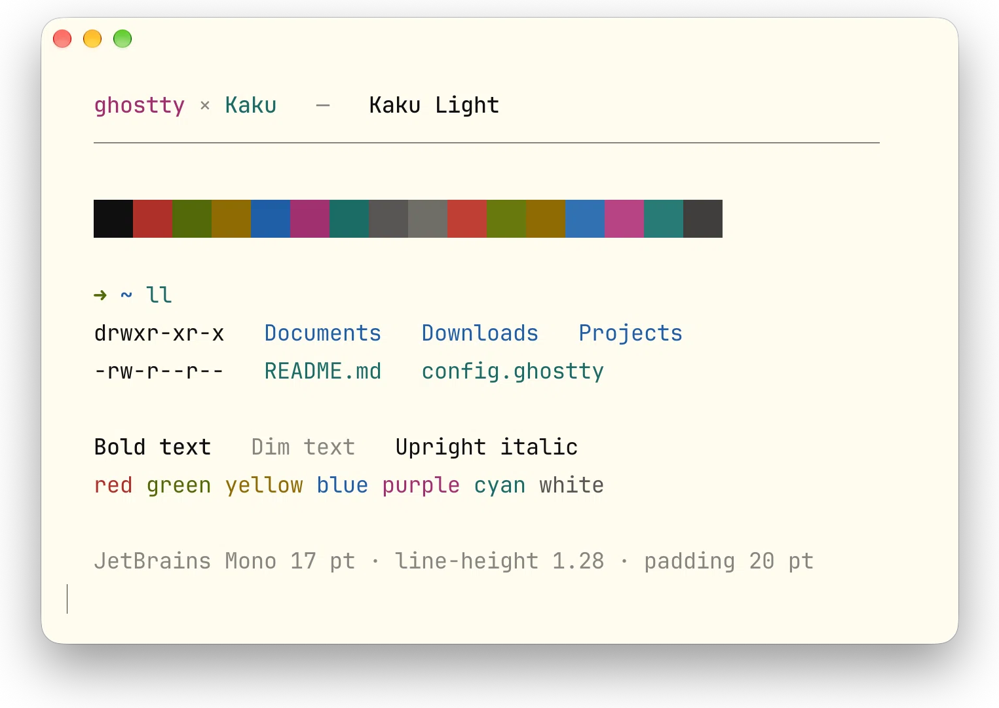

# ghostty-config

[](https://github.com/kesonglab/ghostty-config/actions/workflows/ci.yml)
[](https://github.com/kesonglab/ghostty-config/releases)
[](LICENSE)
[](https://www.apple.com/macos/)
[](https://ghostty.org/)

> 将 Kaku 0.30 的默认终端配置逐项移植到 Ghostty 1.4：主题、字体、窗口、交互与键位均对齐 Kaku 默认值，并保留 Ghostty 的毛玻璃模糊。

| Kaku Dark | Kaku Light |
| :---: | :---: |
|  |  |

## 特性

- **主题**：Kaku Dark 与 Kaku Light 两套完整调色板（背景、前景、光标、选中与 ANSI 0–15），随 macOS 深浅色自动切换。
- **排版**：JetBrains Mono 17 pt、行高 1.28、关闭编程连字、斜体保持直立、粗体使用 Medium 字重；中文回退 PingFang SC，符号回退 Apple Symbols。
- **键位**：对齐 Kaku 默认键位，涵盖标签、分屏、光标行编辑、字号与 Quick Terminal 等常用操作，无需额外配置。
- **窗口**：内边距 20 pt、初始 110 × 22、透明标题栏与系统红绿灯、10000 行滚动缓冲、关闭确认。
- **模糊**：保留 Ghostty 的高斯模糊（`background-opacity = 0.9`、`background-blur = 18`）。
- **校验**：主配置与两个主题文件均通过 `ghostty +validate-config`，CI 持续执行配置校验与文档检查。

## 快速开始

环境要求：Ghostty 1.4 及以上，macOS 13 及以上。

```bash
# 1. 安装 Ghostty 与字体
brew install --cask ghostty
brew install --cask font-jetbrains-mono-nerd-font

# 2. 安装主配置
cp config.ghostty "$HOME/Library/Application Support/com.mitchellh.ghostty/config.ghostty"

# 3. 安装主题（Ghostty 只从该目录读取自定义主题）
mkdir -p "$HOME/.config/ghostty/themes"
cp themes/"Kaku Dark" themes/"Kaku Light" "$HOME/.config/ghostty/themes/"

# 4. 校验；随后在 Ghostty 内按 Cmd + Shift + , 热重载
ghostty +validate-config
```

`ghostty` 不在 `PATH` 时先建立软链：

```bash
ln -s /Applications/Ghostty.app/Contents/MacOS/ghostty /usr/local/bin/ghostty
```

> 预览截图使用不透明背景，以便对比配色；默认配置保留毛玻璃模糊。

## 主题

| | Kaku Dark | Kaku Light |
| :--- | :--- | :--- |
| 背景 | `#15141b` | `#fffcf0` |
| 前景 | `#d5d4d6` | `#100f0f` |
| 光标 | `#8e6ad9` | `#343331` |
| 选中 | `#584384` | `#e8e6db` |

- 主题文件位于 `themes/`，文件名即主题名，需与 `theme = light:Kaku Light,dark:Kaku Dark` 完全一致（含空格与大小写）。
- Kaku 的选中色为 `rgba(142,106,217,0.55)`，Ghostty 主题不支持 alpha，按 Kaku Dark 背景合成为等效不透明色 `#584384`。
- 自定义主题目录固定为 `~/.config/ghostty/themes/`，而非 `~/Library/Application Support/com.mitchellh.ghostty/themes/`。

## 快捷键

| 快捷键 | 动作 |
| :--- | :--- |
| `Cmd + T` / `Cmd + W` / `Cmd + N` | 新建标签 / 关闭当前分屏 / 新建窗口 |
| `Cmd + Shift + W` | 关闭当前标签页 |
| `Cmd + 1..8` / `Cmd + 9` | 切到第 N 个标签 / 最后一个标签 |
| `Cmd + Shift + [` / `]` | 上一个 / 下一个标签 |
| `Cmd + D` / `Cmd + Shift + D` | 左右分屏 / 上下分屏 |
| `Cmd + Alt + 方向键` | 在分屏间跳转 |
| `Cmd + Ctrl + 方向键` | 调整分屏尺寸（步长 5） |
| `Cmd + Shift + Enter` | 最大化 / 还原当前分屏 |
| `Cmd + Shift + ↑` | 当前窗口置顶 |
| `Cmd + Ctrl + F` | 全屏 |
| `Cmd + K` / `Cmd + R` | 清屏并清空滚动缓冲 |
| `Cmd + Enter` / `Shift + Enter` | 换行但不执行 |
| `Opt + ←/→` / `Cmd + ←/→` | 按词跳转 / 跳到行首行尾 |
| `Cmd + Backspace` / `Opt + Backspace` | 删除到行首 / 删除前一个词 |
| `Cmd + Shift + I` | 重命名标签页 |
| `Cmd + Opt + Ctrl + K` | 全局呼出 / 收起 Quick Terminal |
| `Cmd + Shift + ,` | 重载配置 |

## 配置速览

| 项目 | 取值 |
| :--- | :--- |
| 主题 | `theme = light:Kaku Light,dark:Kaku Dark` |
| 字体 | `font-family = JetBrains Mono`（回退 Nerd Font / PingFang SC）、`font-size = 17` |
| 行高与连字 | `adjust-cell-height = 28%`、`font-feature = -calt,-clig,-liga` |
| 窗口 | `window-padding-x = 20`、`window-padding-y = 20,0`、`window-width = 110`、`window-height = 22` |
| 光标 | `cursor-style = bar`、`cursor-style-blink = true` |
| 滚动 | `scrollback-limit-lines = 10000`、`scrollbar = never` |
| 鼠标与选择 | `copy-on-select = clipboard`、`mouse-hide-while-typing = true` |
| 可读性 | `minimum-contrast = 3`、`unfocused-split-opacity = 1` |
| 关闭保护 | `confirm-close-surface = true` |
| 模糊 | `background-opacity = 0.9`、`background-blur = 18` |

各配置项的来源与对照说明见 [`config.ghostty`](config.ghostty) 内的注释。

## 自定义

在 `config.ghostty` 末尾追加覆盖项即可生效。

恢复不透明背景：

```ini
background-opacity = 1
background-blur = false
```

隐藏标题栏文字，以更接近 Kaku 的观感（Mission Control 与标签页将不再显示标题）：

```ini
title = " "
```

低分辨率屏幕可改回 Kaku 的 15 pt：

```ini
font-size = 15
```

## 与 Kaku 的差异

- **标签栏**：Kaku 为底部自绘标签栏；Ghostty 仅支持原生或标题栏标签（单标签时自动隐藏）。配置层无法实现底部标签栏，需修改 Ghostty 源码。
- **标题文字**：Kaku 标题栏只保留红绿灯；Ghostty 默认显示窗口标题，可通过上文的 `title = " "` 隐藏。
- **主题字重与颜色映射**：Kaku 按深浅色切换字重（Regular/Medium 与 Medium/SemiBold），并通过 `color_overrides` 将 ANSI 黑/白按前景与背景分别映射；Ghostty 无对应机制，本配置按深色主题对齐。
- **Shell 提示符**：Kaku 自带托管 zsh（语法高亮、自动建议、自定义提示符）；Ghostty 仅注入 shell integration，提示符沿用现有 `.zshrc` 配置。
- **专属功能**：Kaku 的 AI Chat、lazygit、yazi、远程文件、Doctor、标签导航等在 Ghostty 中无对应功能。

## 验证

- 静态校验：主配置与两个主题文件执行 `ghostty +validate-config`，结果均为 0 error，CI 同步执行。
- 渲染测量：单元格 20 × 58 设备像素（2× 屏幕）；Kaku Dark / Light 调色板与主题文件逐项一致（±1 舍入）；深浅色自动切换正常。
- 文档检查：markdownlint 0 issue。

## 项目结构

```text
ghostty-config
├── config.ghostty          # 主配置（Kaku 0.30 → Ghostty 1.4）
├── themes/
│   ├── Kaku Dark           # Kaku 深色主题
│   └── Kaku Light          # Kaku 浅色主题
├── assets/
│   ├── preview-dark.png    # Kaku Dark 预览截图
│   └── preview-light.png   # Kaku Light 预览截图
├── CHANGELOG.md            # 版本记录
├── CITATION.cff            # 引用元数据
├── .github/workflows/ci.yml
├── .markdownlint-cli2.jsonc
├── LICENSE
└── README.md
```

## 参考

- [Kaku](https://github.com/tw93/Kaku)：配色与默认行为的来源
- [Ghostty](https://ghostty.org/docs/config/reference)：配置参考
- [JetBrains Mono](https://www.jetbrains.com/lp/mono/) 与 [Nerd Fonts](https://www.nerdfonts.com/)
- 引用本工程请使用 [`CITATION.cff`](CITATION.cff)；完整变更见 [CHANGELOG.md](CHANGELOG.md)

## License

[MIT](LICENSE) © kesonglab
